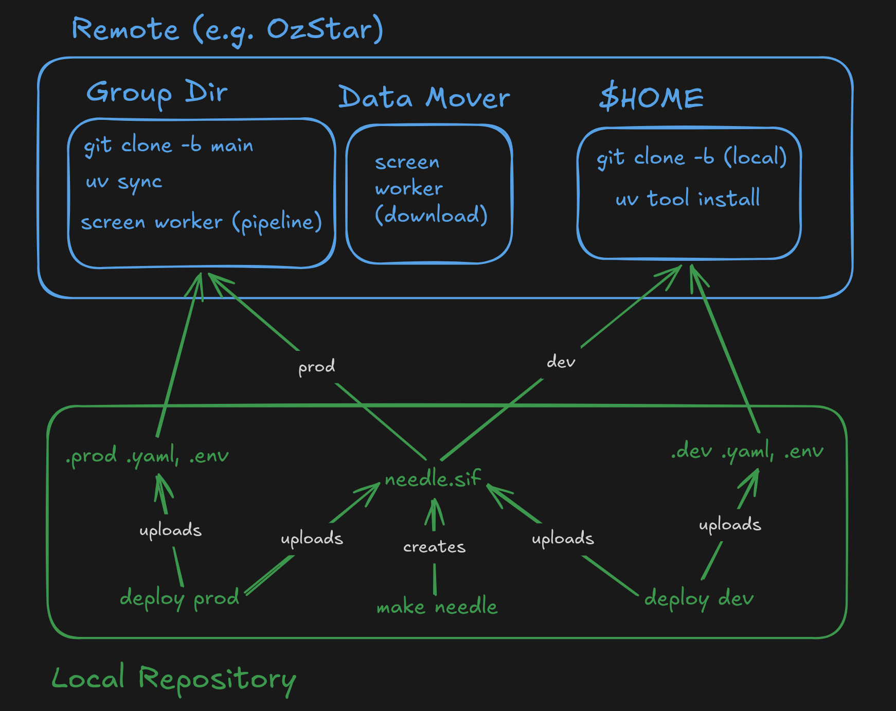

# Installation & Setup

## Python Needle Local Install

Needle can be installed the regular way as it utilises a `pyproject.toml`

```bash
pip install .

# editable:
pip install -e .

# Include CASA libraries for local environment execution
pip install -e ".[casa]"

# Include test libraries
pip install -e ".[tests]"

# Run with
needle
```

Or, if you prefer to use [UV](https://docs.astral.sh/uv/getting-started/installation/)

```bash
uv sync .

# Include CASA libraries for local environment execution
uv sync --extra casa

# Include test libraries
uv sync --extra tests

# Run with
uv run needle # in the repository directory
# or source from the local directory
source .venv/bin/activate
# and run globally
needle

# Or install globally with
uv tool install --editable .
# Then run with
needle
```

## Containers

There are two custom containers:

- needle-base: Mainly contains [CASA](https://casadocs.readthedocs.io/en/stable/index.html) (modular) and [WSClean](https://wsclean.readthedocs.io/en/latest/)
- needle: Builds from needle-base. Installs the needle python package and sets up the CASA and data directories

There is a makefile to build all of the containers

```bash
# Build everything
make all

# Build base
make base

# Build needle
make needle

# Build the apptainer container
make apptainer

# Clean build artifacts
make clean
```

## Deploying needle (prod/dev)

`needle deploy` updates a remote git checkout, installs the Python environment, creates configured directories, optionally uploads a SIF image, and optionally starts the production workers.



### Layout

|                  | Production                                                       | Development                                                           |
| ---------------- | ---------------------------------------------------------------- | --------------------------------------------------------------------- |
| Code checkout    | `/fred/oz513/software/needle`                                    | `$HOME/software/needle`                                               |
| Environment file | `$HOME/.needle.prod.env`                                         | `$HOME/.needle.dev.env`                                               |
| Config files     | Set by `NEEDLE_CONFIG` / `NEEDLE_CLUSTER_CONFIG` in the env file | same                                                                  |
| Image location   | `container.image` in the cluster config                          | `container.image`, falling back to `$HOME/software/images/needle.sif` |
| Workers          | Started by default                                               | None                                                                  |

The environment file is the source of truth for the config paths. A deployment looks for the canonical local env file in
the source checkout (`.needle.<env>.env`) or the path passed with `--env-file`, then uploads it to the remote env-file
path with mode `0600`. If no local env file is found, the existing remote env file is used unchanged.

Deployment also looks for environment-specific config files in the local source checkout and uploads them to those
paths:

- Production: `.needle.prod.yaml` and `.needle_cluster.prod.yaml`
- Development: `.needle.dev.yaml` and `.needle_cluster.dev.yaml`

If a local file is absent, the existing remote config is left untouched.

Both environment files should export the Prefect credentials and point at their config files:

```bash
export PREFECT_API_URL="https://prefect.ips-askap.cloud.edu.au/api"
export PREFECT_API_AUTH_STRING="admin:password"

# Production env file
export NEEDLE_CONFIG="/fred/oz513/software/config/needle.prod.yaml"
export NEEDLE_CLUSTER_CONFIG="/fred/oz513/software/config/needle_cluster.prod.yaml"

# Development env file
export NEEDLE_CONFIG="$HOME/software/config/needle.dev.yaml"
export NEEDLE_CLUSTER_CONFIG="$HOME/software/config/needle_cluster.dev.yaml"
```

The local source files remain `.needle.prod.yaml`, `.needle_cluster.prod.yaml`, `.needle.dev.yaml`, and
`.needle_cluster.dev.yaml`; deployment installs each to the corresponding remote path above. To load a local env file
before any CLI command, put the global option before the subcommand:

```bash
needle --env-file .needle.dev.env deploy dev
needle --env-file .needle.prod.env deploy prod
```

It can also be set with `NEEDLE_ENV_FILE`. During `deploy`, the same file is uploaded to the selected environment's
remote env-file path.

### Commands

```bash
# Production: update code, uv sync, start workers
needle deploy prod

# Production without workers: code/image install only
needle deploy prod --no-workers

# Upload an existing SIF
needle deploy prod --upload-image /path/to/needle.sif
needle deploy dev --upload-image /path/to/needle.sif

# Restart already-running production screens after the code update
needle deploy prod --restart-workers

# Development install under $HOME/software/needle; never starts workers.
# Also installs an editable `needle` command into ~/.local/bin.
needle deploy dev
```

Image building is not part of the deploy command. Build the SIF externally with `make needle` and `apptainer build`,
then pass it with `--upload-image PATH`. Deployment uploads that SIF to the `container.image` path from the
environment's cluster config. For development, if the config has no `container.image`, it falls back to
`$HOME/software/images/needle.sif`. Directories for the checkout, configs, image, and local paths found in the two
YAML configs are created if missing.

A development deployment runs `uv sync` and then `uv tool install --editable "$HOME/software/needle" --force`, so the
`needle` command uses the development checkout from any directory. Production deployments do not install a global
tool; the workers keep using `uv run needle` from the production checkout. This is intentional.

Status, teardown, and deployment use the same environment names:

```bash
# Check whether production is ready: config/env/image, Prefect resources, deployments, workers, and screens
needle deploy status prod

# Check whether development is ready: config/env/image and installed tools
needle deploy status dev

# Stop production screens. Dev has no workers so this is a no-op on dev.
needle deploy teardown prod
```
