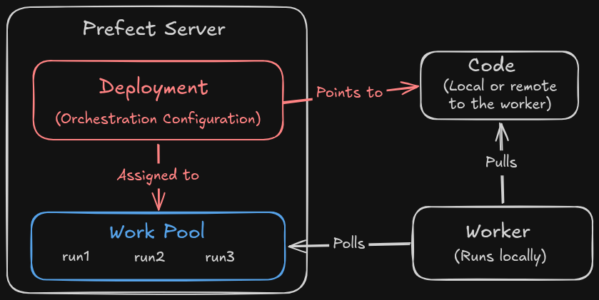
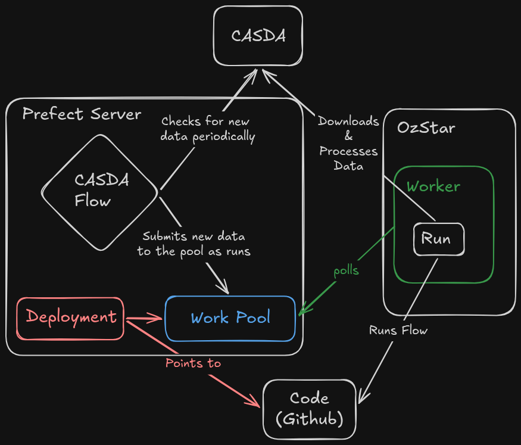

# Operating Modes

## Production

The production setup is fundamentally different to the [development setup](/docs/index.md#quickstart-ozstar-dev). The
production mode relies on a few prefect-native concepts:

- **[Deployment](https://prefect-docs-preview.netlify.app/concepts/deployments)** - A set of instructions/configuration for when, where and how to run a flow
- **[Work Pool](https://prefect-docs-preview.netlify.app/concepts/work-pools)** - Manages and organises the work for execution
- **[Worker](https://prefect-docs-preview.netlify.app/concepts/work-pools/?utm_source=chatgpt.com#worker-overview)** - Polls the work pool for available work and executes it.

A typical setup might look like this:



So our deployment and work pool information lives on the [Prefect Server](https://github.com/ADACS-Australia/RChhetri-2026B)
and our workers, when they are active, poll the work pool for new runs to execute. When they find something, they
execute the flow code that they find on Github (this repository - which the deployment points to).

### CASDA Automated Retrieval Pipeline

This is all well and good, but it doesn't answer the question of how the setup knows when there is work to be done to
begin with. For that, we need to periodically query the [CASDA catalog](https://data.csiro.au/domain/casdaObservation).



On our [remote VM](https://github.com/ADACS-Australia/RChhetri-2026B), there is a flow running that checks the CASDA
catalog for newly deposited observations. When it finds something, the observation is matched to its calibrator
observation (by looking at the .fits header of the visibility cube). This flow then triggers the _download_ flow and
passes the SB ID of the target and calibrator observations. This flow run gets added to the work pool.

Now on OzStar, we have two workers running - the download worker and the pipeline worker. The download worker polls the
work pool for new runs. When it finds something, its flow begins and it starts to download the target and calibrator
observations (on the data-mover node). Once this download is complete, the pipeline flow is triggered and handed the
download directory. It runs as normal, processing the data with the provided production configuration files.

> You may be asking, "why not have all 3 flows on OzStar?". The answer is that it is essential that the CASDA flow runs
> 24/7 in order to pick up the newest released observations. OzStar (indeed, any HPC cluster) will have a small amount
> of downtime, which will kill any running worker on the login and data mover nodes. If the CASDA flow was running on
> OzStar, we would miss any newly released observations for the duration of the outage. The download and pipeline flow
> runs are simply consumed as the workers become available, so any runs submitted during downtime get picked up when
> they come back online.

## Pre-Calibrated Solution

This operating mode is useful when the user has a set calibrated visiblities and wants to process them with the
pipeline flow. Running in this mode will skip the flagging and calibration steps as they're not required for a
pre-calibrated input.

The pipeline will run in this mode automatically if it detects calibrated visibilities in the work directory. Its method
of detection is simply a filename matcher. It expects something that looks roughly like:

```
SBXXXXX*beamXX*_calibrated.(uvfits/ms/mir)
```

If it finds calibrated visibilities, it will ignore other inputs, such as the target and calibrator files.
